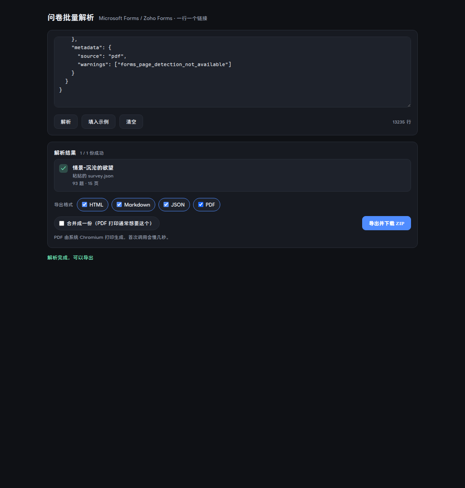

# survey-tool — 批量问卷解析与导出

一个独立可执行程序：吃进来一堆问卷链接或 JSON，吐出来 HTML / Markdown / JSON / PDF。

它**不是**第二套解析实现。抓取逻辑直接复用 `src/services/microsoft-forms.service.ts`
与 `src/services/zoho-forms.service.ts`，排版与导出复用 `admin/src/lib/survey-export.ts`
——和后台网页端是同一份代码。网页端改了导出排版，命令行重新编译一次就同步；
不会出现「网页导出好看、命令行导出错位」这种两套实现必然产生的漂移。

## 两种用法，一个程序

| 怎么启动            | 得到什么                                        |
| ------------------- | ----------------------------------------------- |
| **双击 / 不带参数** | 本地 Web 界面，浏览器里粘贴、预览、一键下载 ZIP |
| 带参数              | 命令行，行为与旧版完全一致                      |

```bash
./survey-tool                    # → Web 界面（自动监听 127.0.0.1:8799）
./survey-tool --port 9000        # → Web 界面，换端口
./survey-tool --help             # → 命令行帮助
./survey-tool urls.txt --merge   # → 命令行批量导出
```

判断规则很简单：只出现 `--port` / `-p` / `--open`（或完全没有参数）就是 Web，
出现任何其它参数就是 CLI。所以老脚本一行都不用改。

## Web 界面



**流程**

1. 每行粘一个链接（或把 `.txt` 直接拖进输入框）
2. 点「解析」→ 逐条显示标题 / 题数 / 页数，失败的那条当场给出原因
3. 勾选格式（HTML / Markdown / JSON / PDF），需要合集就勾「合并成一份」
4. 点「导出并下载 ZIP」→ 浏览器收到一个 `surveys-20261028-1130.zip`

**ZIP 里有什么**

```
情景-沉沦的欲望.html
情景-沉沦的欲望.md
情景-沉沦的欲望.json
情景-沉沦的欲望.pdf        ← 勾了 PDF 才有
导出报告.md                 ← 有失败或警告时才出现
```

失败清单会落一份进 ZIP 而不是只在前端一闪而过——用户下载完还能回头知道哪几条没成功。

**也接受直接粘贴 survey.json**

输入框内容以 `{` 开头时，整段当作一份问卷处理，不走网络。这条路径用来验证渲染
链路，也是手上已有 `survey.json` 时的最短路径。

**安全边界**

- 只监听 `127.0.0.1`，不对外网开放
- 校验 `Host` 头（`127.0.0.1` / `localhost` / `::1`），挡 DNS rebinding
- 请求体上限 1 MB，一次最多 200 条链接
- 抓取目标白名单来自 `isFormsUrl` / `isZohoUrl`，**不是任意 URL**——这是它和「开放代理」的区别

## 命令行

```bash
# 单份
./survey-tool ./survey.json --out ./out

# 批量：把链接每行一条粘进来
./survey-tool --stdin --format html,md,json,pdf --merge < urls.txt

# 直接给链接
./survey-tool https://forms.office.com/r/xxxxxxxxx
```

默认输出到 `./survey-out/`，默认格式 `html,markdown,json`。

### 输入

| 类型                             | 说明                                                                   |
| -------------------------------- | ---------------------------------------------------------------------- |
| `https://forms.office.com/…`     | Microsoft Forms，实时抓取并转换                                        |
| `https://forms.zohopublic.com/…` | Zoho Forms，同上                                                       |
| `*.json`                         | 标准 survey.json（需要有 `survey.questions`；也认 `questions` 在顶层） |
| `*.txt`                          | 文本清单，每行一个链接；`#` 开头当注释                                 |

`--stdin` 从标准输入读同样的内容，适合直接粘贴一批链接。
重复链接自动合并，空行与注释忽略。

### 选项

| 选项              | 作用                                               |
| ----------------- | -------------------------------------------------- |
| `--out <目录>`    | 输出目录（默认 `./survey-out`）                    |
| `--format <列表>` | `html,md,json,pdf` 任意组合（默认 `html,md,json`） |
| `--merge`         | 合并成一份「问卷合集」，PDF 场景通常想要这个       |
| `--stdin`         | 从标准输入逐行读                                   |
| `--json`          | 把解析结果打到 stdout，不落盘                      |
| `--port <n>`      | Web 模式端口（默认 8799）                          |
| `--open`          | Web 模式启动后打开浏览器                           |

## 编译

```bash
pnpm build:tool     # 三平台 → tools/survey-tool/dist/
```

产物：

| 平台        | 文件                          | 体积    |
| ----------- | ----------------------------- | ------- |
| Linux x64   | `survey-tool-linux-x64`       | ~87 MB  |
| Windows x64 | `survey-tool-windows-x64.exe` | ~111 MB |
| macOS arm64 | `survey-tool-darwin-arm64`    | ~86 MB  |

体积主要是 Bun 运行时本身。没有额外依赖：ZIP 打包是 `zip.ts` 里手写的 90 行，
PDF 借系统 Chromium，不打包浏览器。

## 自检

```bash
pnpm survey:selftest
```

不启动 HTTP，直接验内核：

- 分页字段兼容（`page_id` 字符串 / `pageId` 数字）
- 真实问卷（仓库根 `survey.json`）渲染后**题目一条不少**
- 输入清洗（去重、注释、跳过计数）
- ZIP 格式（`python3 zipfile` 校验中文名与 CRC）
- PDF 渲染（需要 Chromium，没有就跳过）
- 文件名清洗

## 文件结构

| 文件          | 职责                                                    |
| ------------- | ------------------------------------------------------- |
| `main.ts`     | 统一入口：判断走 Web 还是 CLI                           |
| `core.ts`     | 解析、PDF 渲染、命名规则——**CLI 与 Web 共用，只此一份** |
| `index.ts`    | 命令行                                                  |
| `server.ts`   | 本地 Web 服务（`Bun.serve`）                            |
| `page.html`   | 单页界面，编译时内联进二进制                            |
| `zip.ts`      | 极简 ZIP 打包器（deflate / store 双模）                 |
| `selftest.ts` | 内核自检                                                |

`core.ts` 存在的理由见文件头：上一轮 CLI 和网页端各认一种分页字段
（`page_id` 与 `pageId`），结果一边导出的 PDF 里题目被**静默丢弃**且没有任何报错。
共享内核让这种分叉不可能再发生。

## 已知边界

| 项                                | 说明                                                                                                                                                                                                        |
| --------------------------------- | ----------------------------------------------------------------------------------------------------------------------------------------------------------------------------------------------------------- |
| PDF 需要 Chromium                 | 找不到就跳过 PDF 并给出提示，其余格式照常。Linux 下装 `chromium` 或用 Playwright 缓存                                                                                                                       |
| 中文文件名在旧版 `unzip` 显示乱码 | ZIP 用标准的 UTF-8 文件名 flag（`0x0800`）。7-Zip / Windows 资源管理器 / macOS 归档工具 / `python3 zipfile` 都正常；Info-ZIP `unzip` 6.0 及更早版本不认这个 flag，显示乱码但内容无损（`unzip -t` 校验通过） |
| Windows / macOS 产物未实机验证    | 交叉编译成功；Linux 版已在本机跑通 Web、CLI、PDF 全链路                                                                                                                                                     |
| Web 只做本机                      | 不提供鉴权，也没有远程访问的设计意图。要给别人用，就把 `dist/` 里的二进制发给他                                                                                                                             |
